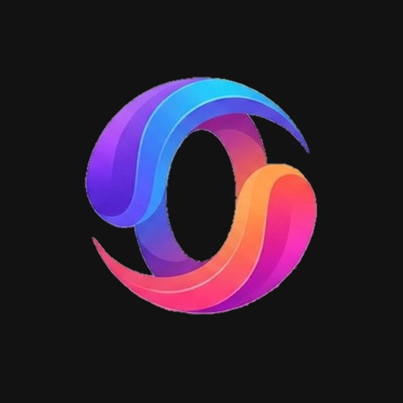

<div align="center">



# Spectro

### High-Fidelity YouTube Music Client for Android & Windows

[](https://github.com/NazarYosa/Spectro/releases)
[](https://github.com/NazarYosa/Spectro/stargazers)
[](https://github.com/NazarYosa/Spectro/releases)
[](https://github.com/NazarYosa/Spectro/releases)
[](https://github.com/NazarYosa/Spectro/releases)
[](https://github.com/NazarYosa/Spectro/releases)
[](https://github.com/NazarYosa/Spectro)
[](LICENSE)

<br/>

**Spectro** is a modern, high-performance, ad-free music streaming client engineered natively for **Android** and **Windows**. It is designed with refined visual aesthetics, intelligent radio queue curation, synchronized multi-source lyrics, a real-time parametric equalizer, and instant cross-device synchronization.

</div>

---

## 📑 Table of Contents

- [Key Features](#-key-features)
- [System Architecture](#-system-architecture)
- [Download & Installation](#-download--installation)
- [Building from Source](#-building-from-source)
- [Documentation](#-documentation)
- [License](#-license)

---

## ✨ Key Features

### 🧠 1. Smart Radio Queue Engine
- **Single-Genre Locked Recommendations**: Eliminates genre drift by anchoring recommendations strictly to the musical DNA of the current seed song.
- **Dynamic Popularity Shuffling**: Dynamically mixes top chart-topping hits with fresh discoveries.
- **Unique on Every Play**: Navigating away and returning to a song generates a fresh, uniquely randomized queue order.
- **Artist Interleaving**: Prevents artist clustering so no single artist appears more than twice consecutively.
- **Aggressive Negative Filtering**: Automatically strips out low-quality covers, nightcore, slowed+reverb, live bootlegs, and duplicate uploads.
- **Infinite Continuation**: Seamlessly fetches radio continuation batches when reaching the end of the queue without looping.

### 🎤 2. Multi-Source Synced Lyrics
- **7-Provider Waterfall**: Searches across *BetterLyrics, Paxsenix (Apple Music), LyricsPlus (Musixmatch), LrcLib, KuGou, YouTube Music, and YouTube Captions*.
- **Parallel Probing**: Queries providers in parallel and exposes a dynamic dropdown showing only sources that have lyrics for the playing track.
- **Word-by-Word & Line Synced**: Supports fluid karaoke-style word highlighting and smooth line-by-line auto-scrolling.
- **Customizable Priority**: Reorder and toggle lyrics sources in Settings according to your preference.

### 🎛️ 3. Parametric Equalizer & Bass Boost
- **Real-Time Sound Processing**: Direct integration with the Web Audio API on Windows (`AudioContext` with 5-band biquad filters) and native audio effects on Android.
- **Hardware Bass Booster**: Deep low-end frequency enhancement without clipping or distortion.
- **Studio Presets**: Quick access to presets including *Bass Booster, Clear Vocal, Rock, Pop, Jazz, Hip-Hop, Acoustic, and Electronic*.

### 📱💻 4. Spectro Connect (Cross-Device Sync)
- **Frictionless 6-Digit PIN Pairing**: Instantly link your Android phone with your Windows PC over a secure, temporary MQTT channel without entering passwords or registering Google Cloud API keys.
- **Bi-Directional Status**: Real-time connected device status display on both devices.

### 🌐 5. Native System Language Adaptation
- **Auto-Detection**: Automatically detects whether your system is in English or Indonesian.
- **Natural Language**: Clear, friendly, non-technical terminology throughout all menus and settings.
- **Manual Override**: Change display language at any time in Settings.

### 🛡️ 6. Pure Streaming & Privacy-First
- **Zero Disk Bloat**: Streams audio on demand without accumulating hidden multi-gigabyte cache directories.
- **Zero Telemetry**: No tracking cookies, no Google Analytics, no Firebase, and no third-party diagnostics.

---

## 📥 Download & Installation

Visit the [GitHub Releases](https://github.com/NazarYosa/Spectro/releases) page to download pre-built installers:

### 📱 Android (Android 8.0+)
- **`Spectro-v1.0.6-universal.apk`**: Compatible with all Android devices (recommended).
- **`Spectro-v1.0.6-arm64-v8a.apk`**: Optimized for modern 64-bit devices (smaller file size).
- **`Spectro-v1.0.6-armeabi-v7a.apk`**: For older 32-bit devices.

### 💻 Windows (Windows 10 / 11)
- **`Spectro-Setup.exe`**: Standard Windows installer wizard with automatic start menu and desktop shortcuts (recommended).
- **`Spectro.exe`**: Portable standalone executable that runs without installation.

---

## 🛠️ Building from Source

### Prerequisites
- **Git**
- **Android**: JDK 25 and Android SDK
- **Windows**: Node.js 20+ and npm

### 📱 Android Build
```bash
cd spectro-android
./gradlew assembleRelease
```
The compiled APK will be located in `spectro-android/build/outputs/apk/release/`.

### 💻 Windows Build
```bash
cd spectro-windows
npm install
npm run dist
```
The compiled setup wizard and portable executable will be generated in `spectro-windows/release-build/`.

---

## 📚 Documentation

Detailed technical documentation is available in the [`docs/`](docs/) directory:

- [System Architecture](docs/ARCHITECTURE.md) - High-level system design and inter-process communication.
- [Queue Algorithm](docs/QUEUE_ALGORITHM.md) - Deep dive into single-genre locking and dynamic shuffling.
- [Lyrics Engine](docs/LYRICS_ENGINE.md) - Specifications for the 7-provider waterfall and synchronization.
- [Cross-Device Sync](docs/CROSS_DEVICE_SYNC.md) - MQTT 6-digit PIN handshake protocol.
- [Build Guide](docs/BUILD_GUIDE.md) - Step-by-step developer build and packaging instructions.

---

## 📄 License

Spectro is released under the **GNU General Public License v3.0 (GPL-3.0)**. See [LICENSE](LICENSE) for details.
