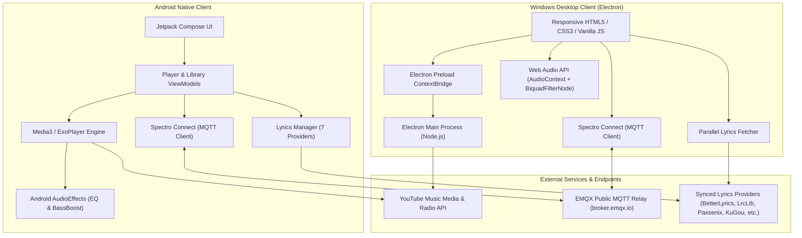

# System Architecture & Design

Spectro is a modern, cross-platform audio streaming client built for **Android** and **Windows**. It bridges low-overhead native hardware integration with reactive user interfaces.

---

## 1. Android Client Architecture

The Android application is written in **Kotlin** and adheres to modern Android architecture principles:

- **UI Layer**: Built entirely with **Jetpack Compose** and Material 3 design tokens.
- **Audio Pipeline**: Leverages **AndroidX Media3 ExoPlayer** running within a foreground service (`PlaybackService`) with full notification controls and lock screen media session integration.
- **Hardware Audio Effects**: Integrates directly with Android's system audio framework (`android.media.audiofx.Equalizer` and `BassBoost`), allowing fine-grained frequency tuning without CPU-intensive software filtering.
- **Process Isolation**: All background synchronizations, network polling, and cache management run on structured coroutines using isolated `CoroutineExceptionHandler` scopes to ensure zero application crashes.

---

## 2. Windows Desktop Architecture

The Windows application is an **Electron-based desktop application** tailored for performance and minimal system overhead:

- **Main Process (`main.js`)**:
  - Handles native window creation, frameless window controls (Minimize, Maximize, Restore, Close), and state persistence.
  - Implements IPC channels (`rate_song`, `edit_playlist`, `create_playlist`, `get_session`, `logout`).
  - Emits window resizing events and manages deep-link protocols.
- **Preload Bridge (`preload.js`)**:
  - Exposes a secure, sandboxed `window.__TAURI__` compatibility bridge to the renderer, allowing secure invocation of main process APIs while keeping `nodeIntegration: false` and `contextIsolation: true`.
- **Renderer Process (`dist/`)**:
  - Pure, modern vanilla JavaScript and GPU-accelerated CSS.
  - **Audio Engine**: Direct connection to the HTML5 audio element via `AudioContext.createMediaElementSource()`, routed through a 5-band parametric equalizer (`BiquadFilterNode`) and a dedicated bass boost node before reaching `AudioContext.destination`.
  - **Dynamic Localization**: Automatically detects operating system locale and provides real-time language switching without page reloads.

---

## 3. Communication & Security Model

- **No Remote Credential Storage**: User session tokens and cookies never leave the local client.
- **Cross-Device Handshake**: When connecting an Android phone to a Windows PC, a temporary 6-digit PIN acts as a single-use rendezvous topic on `broker.emqx.io`. Once credentials are exchanged, the connection is established and the topic is abandoned.
