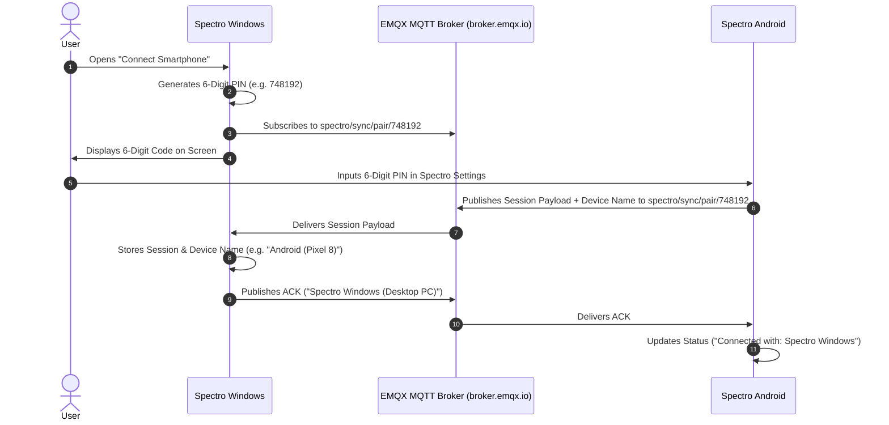

# Cross-Device Account Sync (Spectro Connect)

Spectro Connect allows users to link their Android mobile application and Windows desktop client in seconds using a lightweight 6-digit pairing code over MQTT.

---

## 1. Handshake Flow

---

## 2. Advantages over OAuth / WebView Login

1. **No Google Sign-In Blocks**:
   Google actively blocks embedded WebViews from signing into Google Accounts (Error: `403 disallowed_useragent`). By using Spectro Connect, the user signs in on Android via a trusted browser or account picker and syncs the authorized session to the desktop.
2. **Zero Cloud Infrastructure Maintenance**:
   Uses ephemeral, public MQTT topics with zero persistent server storage. The topic is abandoned immediately after the initial handshake.
3. **Bi-Directional Status Verification**:
   Both clients verify the active connection and display the connected partner's device model in their respective Settings interfaces.
