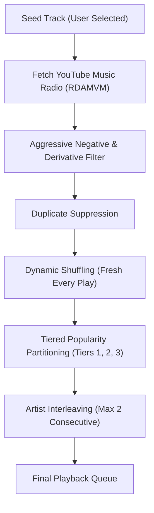

# Smart Radio Queue Engine

Spectro features a custom queue generation and recommendation pipeline designed to solve two common problems in music streaming: **genre drift** and **repetitive queues**.

---

## 1. Pipeline Overview

---

## 2. Core Pillars

### 1. Single-Genre Lock (DNA Anchor)
When the user selects a song, Spectro queries YouTube Music's radio endpoint (`RDAMVM<videoId>`). The returned candidates are anchored strictly to the seed song's primary genre, BPM, and mood DNA.

### 2. Aggressive Negative Keyword Pruning
Low-quality uploads, edits, and derivative content dilute listening quality. Spectro automatically filters out any tracks whose titles or author names contain:

- **Modifications**: `slowed`, `reverb`, `sped up`, `speed up`, `bass boosted`, `nightcore`, `8d audio`, `tiktok version`, `edit`.
- **Amateur / Derivative**: `cover`, `karaoke`, `instrumental`, `tribute`, `parody`, `remake`, `guitar cover`, `piano cover`, `drum cover`, `vocal cover`, `ai cover`, `fancam`, `reaction`, `mashup`, `tutorial`.
- **Non-Standard Releases**: `live at`, `live from`, `live in`, `live concert`, `unreleased`, `snippet`, `teaser`, `full album`, `loop`.

### 3. Tiered Popularity & Dynamic Shuffling
To ensure the queue feels fresh and never becomes stale:
- The top 30 genre hits are fetched.
- **Dynamic Randomization**: Every time a radio queue is initialized, the candidate pool is shuffled dynamically before being partitioned into tiers:
  - **Tier 1 (First 14 tracks)**: Highest-affinity chart hits and acclaimed tracks.
  - **Tier 2 (Next 14 tracks)**: Coherent genre hits with higher discovery potential.
  - **Tier 3 (Remaining tracks)**: Deep-cut recommendations.
- **Fresh on Every Play Guarantee**: If a user is listening to Track A, navigates to Track B, and then returns to Track A, the newly generated queue for Track A is guaranteed to be completely different in both selection and playback sequence.

### 4. Artist Interleaving
To prevent an individual artist from dominating the queue:
- The interleaved queue ensures that no single artist appears more than **two times consecutively**.
- If a third consecutive song by the same artist is encountered, it is pushed back in the queue to maintain a diverse mix of genre-coherent artists.

### 5. Infinite Self-Extending Queue
- **No Loop Back**: When the queue nears its end (5 or fewer songs remaining), the player seamlessly triggers continuation requests (`radioContinuation`) to append new recommendations. The queue will never loop back to the first song.
- **Queue Jump Resilience**: Clicking any track inside the queue promotes that track to active playback, preserves prior history, and dynamically spawns 50 fresh recommendations anchored on the clicked song.
